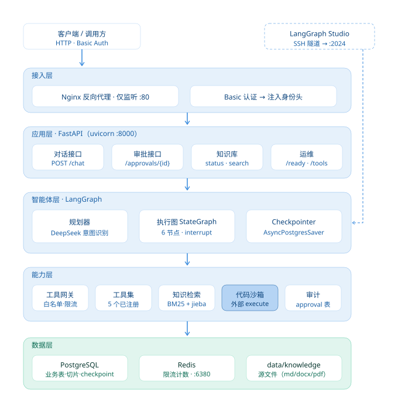

# Personal Agent Platform

自托管的多智能体平台。用连接器把内网办公系统和外网智能体接到一起，知识库和工作流都自己搭，
代码随便改。

FastAPI + LangGraph + PostgreSQL。单机 systemd + Nginx 就能跑，数据留在自己库里。
智能体不是代码里的函数，而是数据库里的一行：有名字、有职责、有工具边界、有开关，
在控制台上改；边界只收窄，从下往上不放宽。

## 系统架构



| 层 | 做什么 | 不做什么 |
|---|---|---|
| 接入层（Nginx） | 反代、下发控制台、Basic 认证后注入身份头；`/mcp` 单独分支给外部智能体 | 不做业务判断，不缓存响应 |
| 应用层（FastAPI） | HTTP 契约、身份解析、参数校验、调执行图 | 不直接碰外部系统，不判断站点授权 |
| 智能体层（LangGraph） | 意图识别、工具循环、中断与恢复、委派、编排 | 不直接发 HTTP，不写审批状态 |
| 能力层 | 工具网关、连接器、MCP 出向、知识检索、写操作审批、回读核验、沙箱、审计 | 不感知 HTTP 请求上下文 |
| 数据层 | PostgreSQL（业务 · RLS · 切片 · checkpoint）、Redis（限流计数）、本地文件（附件与语料） | — |

右侧四块是平台调用的外部系统。凭据留在平台内（`connector_credentials` 挂 RLS），
调用发生在平台外；缺凭据就不调，绝不回退到 `.env`。

## 项目构成

| 目录 | 内容 |
|---|---|
| `app/api/routes/` | HTTP 接口：对话、审批、会话、知识、智能体、技能、编排、连接器、工具、平台管理、入向 MCP、观测 |
| `app/agents/` | LangGraph 执行图：规划器、节点、中断、委派、构建助手 |
| `app/tools/` | 工具注册表与网关；内置工具、远程 MCP、自定义 HTTP、沙箱、场站 |
| `app/knowledge/` | 入库、切片、检索、语义重筛、答复合成、检索评测 |
| `app/orchestration/` | 编排图：定义、编译、运行 |
| `app/services/` | 业务逻辑：审批、连接器、会话与上下文、记忆、模型、租户、审计、备份 |
| `app/models/`＋`alembic/` | ORM 与迁移，schema 的唯一来源 |
| `app/tenancy/` | 租户上下文、RLS、跨租户作用域 |
| `app/integrations/` | 出向客户端：HTTP、MCP、沙箱、场站平台 |
| `app/mcp_server/` | 入向 MCP：外部智能体调进来。只读工具与任务移交，写操作永不在此执行 |
| `static/console/` | 控制台前端，纯 JS，无构建步骤 |
| `deploy/` | systemd、Nginx、防火墙、`sync.sh` 发版脚本 |
| `docs/` | 分层、权限、连接器、知识库、编排等文档 |
| `tests/` | 单元与集成测试，几条不变量各有用例钉住 |

## 使用

### 本地跑起来

```bash
uv sync
cp .env.example .env                      # 填 OPENAI_API_KEY 等
uv run alembic upgrade head               # 建表
uv run python -m scripts.seed_dev_data    # 开发身份（仅 development）
uv run uvicorn app.main:app --reload
```

`curl -s localhost:8000/ready` 会逐项报出数据库、checkpointer、工具注册表、模型配置的状态。

控制台是纯静态文件，页面内所有请求走同源 `/api/v1/*`，不持有凭据。生产由 Nginx 把它挂到
`/console/`；本地不开 Nginx 时直接调接口即可。

### 四条典型链路

- **问一句** — `POST /api/v1/chat`：普通问答、只读工具直调、知识问答（带引用）、写操作先出预览。
- **接一个内网系统** — 控制台「连接器」里填一次地址和认证方式，凭据按租户各存一份，
  工具只记 `connector_id`。OA、工单、台账这类只有内网能访问的系统，接上就能查、能办。
- **建知识库** — 传 Markdown 入库，检索答复带编号引用；无权看的切片连召回候选都进不去。
- **搭工作流** — 跟构建助手说一段话，它起草一张图（起草不落库），确认后保存；
  改一个节点不用重画整张，保存前自动备份。

## 当前边界

- 检索是 BM25（jieba）+ 大模型语义重筛，未接向量库；接口按「先过滤后检索」留好，换实现不影响调用方。
- 写操作一律要人确认，没有自动批准。
- Checkpointer 默认 SQLite，适合单机；多实例换 `PostgresSaver`。
- 连接器没有 OAuth2 / 每用户授权 / 凭据加密存储。

## 文档

| 想知道 | 读 |
|---|---|
| 五层划分与六张图 | [`docs/ARCHITECTURE.md`](docs/ARCHITECTURE.md) |
| 智能体的职责边界 | [`docs/AGENTS.md`](docs/AGENTS.md) |
| 委派、引用传递、配额 | [`docs/A2A.md`](docs/A2A.md) |
| 连接器与凭据分发 | [`docs/CONNECTORS.md`](docs/CONNECTORS.md) |
| 工具来源、自定义 HTTP Tool | [`docs/TOOLS.md`](docs/TOOLS.md) |
| 三态工具策略与风险等级 | [`docs/PERMISSIONS.md`](docs/PERMISSIONS.md) |
| 知识库入库、检索与评测 | [`docs/KNOWLEDGE.md`](docs/KNOWLEDGE.md) |
| 用一段话建编排图 | [`docs/WORKFLOW_AUTHORING.md`](docs/WORKFLOW_AUTHORING.md) |
| 从文件导入知识库 / 技能 / 工具 | [`docs/STUDIO_IMPORT.md`](docs/STUDIO_IMPORT.md) |
| 多租户隔离与 RLS | [`docs/MULTI_TENANCY.md`](docs/MULTI_TENANCY.md) |
| 代码沙箱 | [`docs/SANDBOX.md`](docs/SANDBOX.md) |

## 部署

```bash
bash deploy/install.sh       # 装 systemd 单元与 Nginx 站点（需 root）
deploy/sync.sh --dry-run     # 说明这次会上线哪个提交
deploy/sync.sh --migrate     # 推送 + 停服迁移 + 重启 + 健康检查
```

发版细节、单机拓扑与验收步骤见 [`docs/DEPLOYMENT.md`](docs/DEPLOYMENT.md)；
部署资产在 [`deploy/`](deploy/)。
