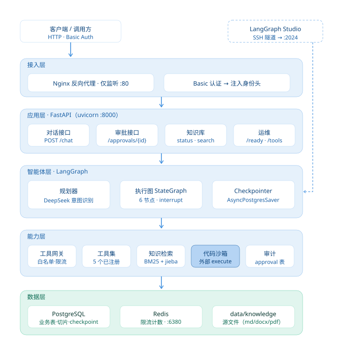
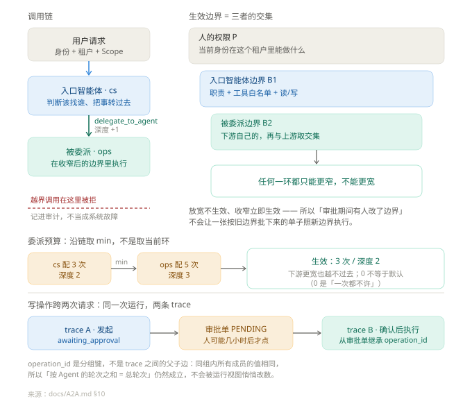
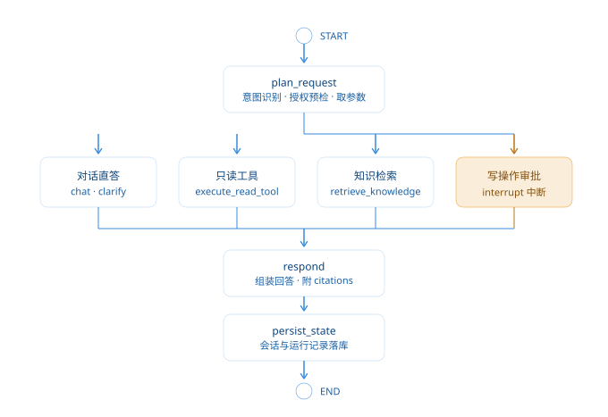
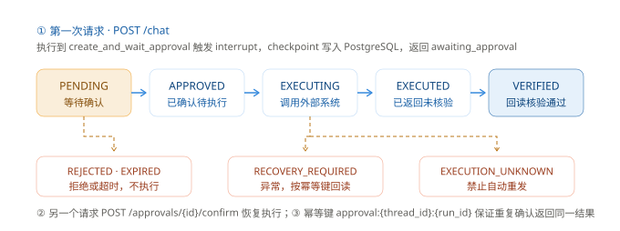
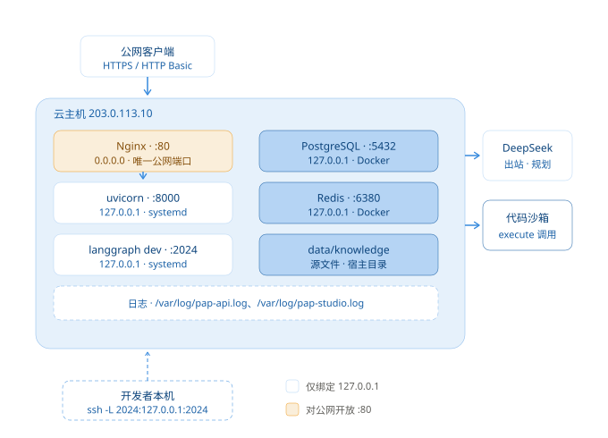
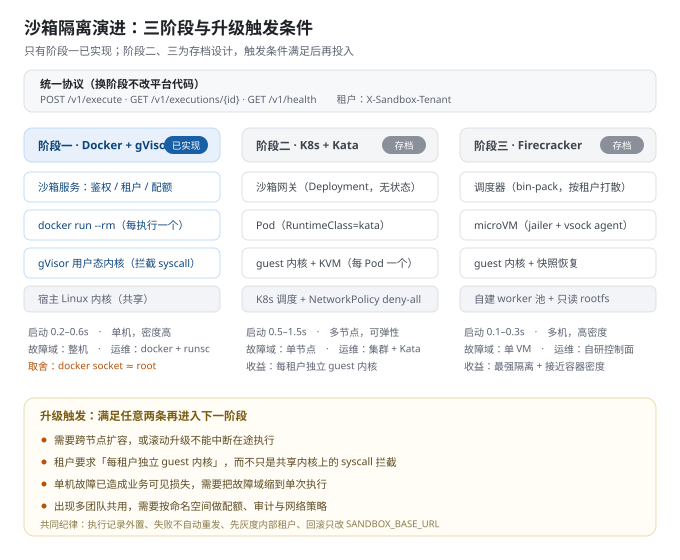

# 系统架构

六张图分别回答六个问题：东西在哪、多个 Agent 怎么协作、请求怎么走、
写操作为什么要跨两次请求、部署边界在哪、沙箱怎么演进。
图源是同目录的 SVG 文件，可直接在浏览器或编辑器中打开，也便于在评审时离线查看。

| 图 | 回答的问题 | 文件 |
|---|---|---|
| 系统架构 | 有哪些层、各层职责与依赖 | [01-system-architecture.svg](architecture/01-system-architecture.svg) |
| 多智能体委派 | 拆开之后权限怎么收、预算怎么算 | [06-multi-agent-delegation.svg](architecture/06-multi-agent-delegation.svg) |
| 执行图 | 一次对话在 LangGraph 里怎么走 | [02-agent-graph.svg](architecture/02-agent-graph.svg) |
| 审批时序 | 写操作为什么需要共享 checkpoint | [03-approval-flow.svg](architecture/03-approval-flow.svg) |
| 部署视角 | 哪些端口对外、进程如何隔离 | [04-deployment.svg](architecture/04-deployment.svg) |
| 沙箱演进 | 三个阶段的隔离差异与升级条件 | [05-sandbox-evolution.svg](architecture/05-sandbox-evolution.svg) |

> 建设顺序、每一阶段明确不做什么，见末图
> [07-build-roadmap.svg](architecture/07-build-roadmap.svg)。

## 1. 系统分层



五层自上而下职责单一，跨层只能向下依赖：

| 层 | 职责 | 不做的事 |
|---|---|---|
| 接入层（Nginx） | Basic 认证、注入身份头、单一公网入口；`/mcp` 单独分支留给外部智能体 | 不做业务判断，不缓存响应 |
| 应用层（FastAPI） | HTTP 契约、身份解析、参数校验、调用执行图 | 不直接碰外部系统，不判断站点授权 |
| 智能体层（LangGraph） | 意图识别、条件路由、中断与恢复、委派、编排 | 不直接调 HTTP，不写审批状态 |
| 能力层 | 工具网关与注册表、连接器、MCP 出向、检索、写操作审批、回读核验、沙箱、审计 | 不感知 HTTP 请求上下文 |
| 数据层 | PostgreSQL（业务 + 切片 + 会话现场）、Redis（限流计数） | — |

图右侧那一列是**平台调用的外部系统**：模型供应商、远程 MCP Server、内网办公系统、
沙箱执行环境。它们不在部署边界内，凭据却存在平台内——`connector_credentials` 挂 RLS，
按租户各一份；缺凭据就 fail-closed，绝不回退到 `.env`。

两个容易看错的地方：

- `data/knowledge` 只是**源文件目录**。切片写在 PostgreSQL 的 `document_chunks`，
  运行时按索引版本号热加载；改完文件必须重跑 `scripts.ingest_knowledge`。
- Redis 只承载限流计数，不是缓存也不是会话存储。它不可用只影响限流
  （默认 fail-closed），不影响对话本身。

## 2. 多智能体：委派与边界



一个 Agent 同时懂客服和运维，等于把两边的权限都给了它。拆开才有边界——
但拆开就带来一个新问题：**下游的权限从哪来？**

答案是一条不能反悔的规则：**任何一环都只能收窄，不能放宽。**

```
生效权限 = 人的权限 P ∩ 入口 Agent 边界 B1 ∩ 被委派 Agent 边界 B2
```

箭头方向是「收」不是「传」：下游拿到的永远是自己那份与上游的交集，
所以链中间任何一个 Agent 被配宽了，也不会把权限漏给更下游——
它只能把整条链收得更紧。

委派预算同一套逻辑，只是取的是**最小值**而不是交集：

| 配置 | cs | ops | 生效 |
|---|---|---|---|
| 每轮委派次数 | 3 | 5 | **3** |
| 委派深度 | 2 | 3 | **2** |

`0` 与 `null` 是两件事：`null` 走平台默认，`0` 是「一次都不许」。
折配置必须用 `narrowed_by()` 这类显式函数，写成 `x or DEFAULT` 会让 `0`
静默变成默认值——这是本仓库已经踩过的坑。

被拒的调用不抛给用户：记进审计（`metadata.limits` 记的是**生效上限**而不是
配置值，才能回答「为什么这次不行」），然后让上层换条路走。

> 委派不是「把请求转过去」。子调用跑在发起方那条 trace 里，所以
> **一个 Agent 可以 0 轮自己的对话、却被叫了 20 次**——`/observability/agents`
> 里 `delegated_turns` 与 `traces` 不能相加，它们的分母不同。

一次运行的时间线：写操作跨两次请求，
用 `operation_id` 这个**分组键**（不是 trace 之间的父子边）串起来。

## 3. 请求执行链路



六节点、四条条件分支，全部收敛到 `respond`。这意味着新增一种意图只需在
`route_after_plan` 增加一个键、并在 `respond` 前插入节点，其余边不用动。

授权预检放在 `plan_request` 而不是审批节点，是被测试逼出来的结论：
`interrupt()` 恢复时会把审批节点整段重跑，如果预检放在那里，
用户已经确认的请求会被再拦一次。

## 4. 写操作审批



写操作是唯一跨越两次 HTTP 请求的路径，这也是 checkpointer 必须是
`AsyncPostgresSaver` 的根本原因：`interrupt` 留下的现场必须被另一个请求
（可能落在另一个进程、另一台机器）读到。

状态机共 10 态，图中画了 9 个。省略的是 `FAILED`：确定性失败，
与 `EXECUTION_UNKNOWN` 的区别是**能不能安全重试**——前者能，后者绝对不能自动重发。

## 5. 部署视角



| 端口 | 绑定地址 | 归属 | 对外 |
|---|---|---|---|
| 80 | 0.0.0.0 | Nginx（宿主） | 是，唯一入口 |
| 8000 | 127.0.0.1 | uvicorn（systemd） | 否 |
| 2024 | 127.0.0.1 | langgraph dev（systemd） | 否，走 SSH 隧道 |
| 5432 | 127.0.0.1 | PostgreSQL（Docker） | 否 |
| 6380 | 127.0.0.1 | Redis（Docker） | 否 |

宿主机 6379 通常被别的 Redis 占用，所以项目自有 Redis 映射到 6380，
避免误连到一个需要认证、且绑在 0.0.0.0 的旧实例。

`DeepSeek` 与 `代码沙箱` 在主机之外，是**出站**依赖。平台自身不执行任何
模型或用户给出的代码，`execute_code` 工具通过 HTTP 把代码委托给沙箱，
协议见 [SANDBOX.md](SANDBOX.md)。

## 6. 图与代码的对应关系

改这些地方时，图需要同步更新，否则图会变成"曾经正确"的文档：

| 改动 | 要动的图 |
|---|---|
| 新增/删除执行图节点或分支 | 02、01（智能体层块） |
| 审批状态增删 | 03 |
| 委派边界的折算法、委派预算的取法变化 | 06 |
| 新增外部依赖或端口 | 01、04 |
| 新增工具或能力层组件 | 01（能力层块） |
| 部署形态变化（多实例、容器化） | 04 |
| 沙箱后端换阶段（gVisor → Kata → microVM） | 05 |

## 7. 沙箱演进



三个阶段共用同一套协议，换阶段只换沙箱服务端实现，平台代码不动。
当前只实现阶段一（Docker + gVisor）：每执行一个一次性容器，无网络、
只读根、无宿主挂载、非 root，执行记录按租户隔离。

阶段二（Kubernetes + Kata）与阶段三（Firecracker Worker Pool）是**存档设计**，
图下半部分是升级触发条件：
它们是判断依据，不是时间表——满足任意两条再投入，否则等于先付运维成本。

## 8. 已知边界

- **索引可见有最多 5 秒延迟**（`KNOWLEDGE_INDEX_REFRESH_SECONDS`），
  入库后各实例不是立即感知。
- **jieba 首次初始化**在第一个请求里同步执行（实测约 0.76s），
  属于已知毛刺，预热可消除。
- **同一 thread 的并发请求未串行化**。checkpoint 只保证不丢，
  不保证不分叉：两个请求并行时会写出两条历史，最终状态取决于谁后写。
  需要应用层用幂等键或 409 拦截。
