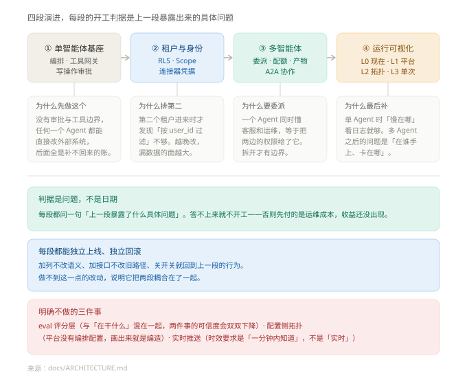

# 建设思路

> 这份文档回答的不是「系统长什么样」（那是 [ARCHITECTURE.md](ARCHITECTURE.md)），
> 而是**为什么长成这个样子**：哪些约束是不能破的、哪些顺序不能换、
> 哪些看起来很该做的东西被明确拒绝了。
>
> 写给两类人：接手维护的人（先看这里，再去读代码），以及要在它上面加功能的人
> （先确认你想加的东西违反了哪一条，再决定是改设计还是改代码）。

---

## 1. 在造的东西是什么

不是「一个能聊天的 AI 应用」，而是**让智能体替人做事的可控执行层**。

这句话决定了三件事：

| 如果是「AI 应用」 | 如果是「可控执行层」 |
|---|---|
| 回答错了，重问一次 | 写错了，外部系统已经变了 |
| 权限是一个功能 | 权限是前提，边界先于能力 |
| 好用就行 | 出事时能说清「谁、在什么时候、凭什么做的」 |

后面每一条原则都从这张表推出来。

---

## 2. 四条不能破的约束

### 2.1 边界只收窄，不放宽

任何一次执行的生效权限，都是「人的权限 ∩ 智能体边界」；委派时再与下游取交集。

```
生效 = P(人) ∩ B1(入口 Agent) ∩ B2(被委派) ∩ …
```

**为什么必须是交集而不是「下游用下游的」**：链中间某一跳被配宽时，
如果下游按自己的边界执行，被放宽的那一段就会悄悄漏过去。取交集之后，
放宽只影响那一环自己，越往下只会越紧。

这条推导出两个实现细节，都不是可选的：

1. **审批要存边界快照。** 单子可能几小时后才被确认，期间 Agent 的边界可能被改。
   执行时取「快照 ∩ 当前」——收窄立即生效，放宽不生效。
   只存 `agent_id` 做不到：期间把只读 Agent 放开成可写，按旧边界批下来的写操作
   就会照新边界执行。
2. **拒绝要记生效上限，不是配置值。** 审计里写 `limits.max_depth=1`，
   才能回答「为什么这次不行」。写配置值（3）只会让人更困惑。

### 2.2 `0` 和 `null` 是两件事

`null` = 走平台默认；`0` = 一次都不许。

这条看似琐碎，但它是最容易在半年后被人「顺手优化」掉的：

```python
depth = limit or DEFAULT_DEPTH     # ✗ 0 变 3
depth = limit if limit is not None else DEFAULT_DEPTH   # ✓
```

同类问题还有：`cost_micros` 没配单价时是 `NULL` 而不是 `0`（`0` 会被读成「免费」）；
`duration_ms` 在残行里留空而不是补一个估计值（编一个时间会让「耗时」凭空多出一段）。

### 2.3 写操作必须跨请求，且必须留现场

写操作不在同一个请求里执行完，而是：预览 → 返回审批卡片 →（人点确认）→ 第二次请求执行。

这是**故意**的，不是实现偷懒：

- 人在环上，就必须有一次「停下来」；
- 停下来之后，进程可能被重启、请求可能落到另一台机器，
  所以 `interrupt` 留下的现场必须在共享存储里（`AsyncPostgresSaver`）；
- 两次请求之间的任何一秒，都可能有人改了 Agent 边界、撤了授权、单子过期。

因此每一次执行前都要**重新复核**：快照还在不在、边界有没有收窄、单子有没有过期。
复核失败要给出明确原因（`DELEGATION_REVOKED` / `AGENT_BOUNDARY_CHANGED`），
而不是笼统的「执行失败」——前者指向「查上游」，后者只会让人重试。

### 2.4 观测是产品的一部分

不是附属的日志，是**判断「该不该留这个 Agent」的唯一依据**。

推论：

- 观测数据可以丢（队列满丢最旧），但**不能拖慢对话**；
- 默认关闭、按环境 opt-in——完整 prompt 落库是开发期的工具，不是生产配置；
- 状态词表在**出口派生**，不改库里的枚举：三处状态各有生命周期，
  任何一处改成「写一个统一 status 列」，立刻会出现两个真相。

---

## 3. 顺序：为什么是这个顺序



四段演进，每一段的开工判据都是**上一段暴露出来的具体问题**，不是日期。

| 段 | 内容 | 开工判据 |
|---|---|---|
| ① 基座 | 编排、工具网关、审批 | 一开始就得有，否则任何 Agent 都能直接改外部系统 |
| ② 隔离 | 租户、身份、Scope、凭据 | 第二个租户进来时发现「按 user_id 过滤」不够；越晚改漏得越多 |
| ③ 多智能体 | 委派、配额、产物、A2A | 一个 Agent 同时懂客服和运维，等于把两边权限都给了它 |
| ④ 运行可视化 | L0 现在 / L1 平台 / L2 拓扑 / L3 单次 | 单 Agent 时「慢在哪」看日志就够；多 Agent 后问题是「在谁手上、卡在哪」 |

两条例外，值得单独说：

**「先做观测基座，再做界面」。** V1 只加两列（`agent_name` / `operation_id`）和一个纯函数，
前端一行不改就能上线。等数据攒起来再做 V2，界面一上线就有内容可看；
反过来先做界面，会得到一个空壳，然后为了填满它去猜数据。

**「残行只标记，不删除」。** 跑到一半进程没了，留下的 `running` 行要改成
`abandoned` 而不是删掉——「昨晚重启影响了几轮」是需要被回答的问题，
删掉等于把事故抹平。

---

## 4. 每段都要能独立上线

判断一个改动是不是把两段耦合了，只看一条：**关掉开关能不能回到上一段的行为**。

已经这么做的例子：

| 改动 | 回退方式 |
|---|---|
| 观测整体 | 开关在控制台「运行配置」（默认开、即时生效），关掉时 `/live` 回 `enabled=false` 而不是 404 |
| 采样 | `OBS_SAMPLE_RATE<1` 时不写起始行，避免留下永不收尾的残行 |
| 技能注入 | `SKILLS_ENABLED=false`，页面照常可编辑，只是不参与规划 |
| 委派预算 | 配 `null` 走默认；单独一列，不影响既有 Agent |

反过来，下面这些是「看起来能回退、其实不能」的，要提前想清楚：

- 新增 NOT NULL 列（老数据填什么？）→ 一律先可空，再用代码兜底；
- 改状态枚举值（历史行怎么读？）→ 在出口派生，不改库；
- 改求和口径（图表会集体失真）→ 新口径单独成列，不做「总耗时」这种含糊列名。

---

## 5. 明确不做

写在前面，免得每次评审都被重新讨论一遍。

| 不做 | 理由 |
|---|---|
| eval / 评分层 | 「他在干什么」和「他干得好不好」混在一起，两件事的可信度会同时下降 |
| 配置侧的「应该是这样」拓扑 | 平台没有编排配置时，硬画等于编造。**现在有了声明层**（`ORCHESTRATION.md`）：声明画虚线、实测画实线，两边不一致本身就是信息，对账成立 |
| 实时推送（WebSocket / SSE） | 时效要求是「一分钟内知道」，不是「实时」。5 秒轮询够用，且不引入长连接状态 |
| 通用服务拓扑（DB、MCP、模型端点都画进去） | 那是 APM 的活。这里只看 Agent 这一层，多画一层就多一层没人维护 |
| 甘特图 / 通用瀑布图组件 | 现有耗时分解够用；泳道是唯一新增形态 |
| 运行重放 / replay | 事件溯源是另一条路。库是事实表，想看过程就打开那条 trace |
| 跨租户拓扑 | 租户是硬边界，委派本身就禁止跨租户 |

---

## 6. 代价账本

每个决定都付了代价，记下来，免得以后被当成缺陷重新「修」一遍。

| 决定 | 付了什么 |
|---|---|
| 委派预算沿链取 min | 想加深必须链上每一环都放宽，改一处不生效 |
| `operation_id` 是分组键不是父边 | 不能直接 rollup。想按运行汇总要显式 `GROUP BY` 并标明「这是运行数」 |
| 状态在出口派生 | 每次查询多一次拼装；换不来一条可以索引的 status 列 |
| 审批存边界快照 | 一张单子多存四列；Agent 改名后历史单子仍显示旧名字（正确，但会有人问） |
| span 整棵树收尾才提交 | 运行中的 trace 没有明细可看，`/live` 只能回答「跑了多久、谁在跑」 |
| 起始行提前落库 | 每轮多一次 INSERT + 一次 UPDATE；进程被 kill 会留残行（所以必须有清扫） |
| 观测默认关闭 | 生产环境默认没有数据，排障要先开开关并重启 |

---

## 7. 怎么判断做对了

**验收必须能反向验证：把实现去掉，测试要变红。**

这条不是洁癖。运行可视化这块最难发现的错误不是「图挂了」，而是
**「图看起来完全正确，但边连错了人」**——它不会报错，只会让人查错方向。

所以每一条验收都配一次刻意的破坏：

| 验收 | 破坏方式 | 期望 |
|---|---|---|
| 起始行先落库 | 去掉 `_submit_begin` | 库里查不到 running 行 |
| 收尾是 UPDATE | 改成新增一行 | 撞唯一约束 / 出现两行 |
| 采样不放残行 | 让 start 也走采样 | 库里留下永不收尾的行 |
| 残行只标记 | 改成 `delete` | 「行还在」断言失败 |
| 委派归属 | 去掉 `bind_agent` | B 的 span 归到 A |
| 委派预算取 min | 改成取当前环 | 下游配 5 就越过了上游的 1 |
| 状态优先级 | 把「trace 已 error」放最前 | `DELEGATION_REVOKED` 被判成 failed |

同一套思路也用在**自检脚本**上：`scripts/check_render.mjs` 里的转义断言，
去掉 `esc()` 必须红——那条路径上是模型输出和用户输入，漏一个就是注入口子。

---

## 8. 接手时先看哪

按这个顺序读，比从头翻代码快：

1. [ARCHITECTURE.md](ARCHITECTURE.md) —— 五层在哪、请求怎么走；
2. [A2A.md](A2A.md) §10 与 [AGENT_QUOTA.md](AGENT_QUOTA.md) —— 委派与预算的完整规则；
3. [RUNTIME_VIEW.md](RUNTIME_VIEW.md) —— 一次运行怎么被观测出来；
4. [LESSONS.md](LESSONS.md) —— 踩过的坑，尤其是「看起来对但错了」的那些；
5. [MANUAL_TEST.md](MANUAL_TEST.md) —— 每条能力对应一个可以亲手跑一遍的用例。

改代码之前先看一眼 `docs/TODO.md` 的「欠账」段：那里记着已知不完美的地方
和它们的成因。**欠账不等于可以随手改**——多数是因为「改它要动两条链路」才留着的。
