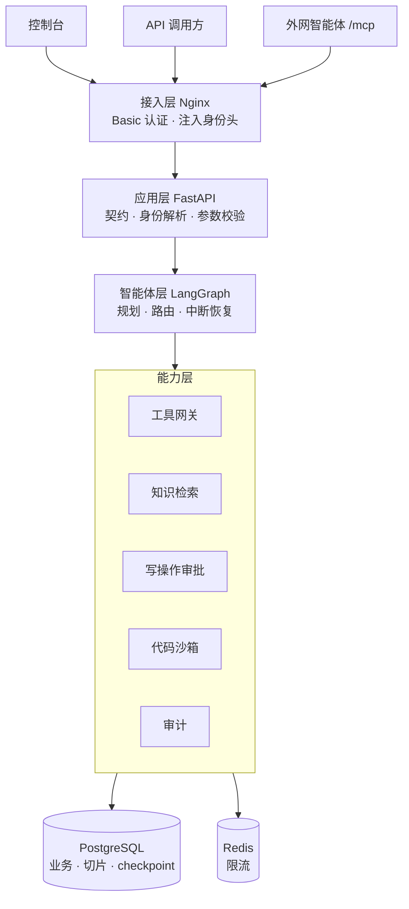

# 多智能体平台实战（一）：先想清楚它不做什么

> 用 LangGraph + FastAPI 搭一个自托管多智能体平台的七个决策。
> 这是第一篇章，讲定位与骨架。后面六篇分别进到图、审批、知识库、连接器、观测、编排。

---

## 系列导航

这七篇不是 API 手册，是一条真实的施工顺序。每篇结构一致：
**What（是什么）→ Why（为什么这样做）→ How（核心代码）→ Trade-off（代价是什么）**。

| 篇 | 主题 | 回答的问题 |
|---|---|---|
| **1** | **定位与骨架** | 它到底是什么，做哪几件事，不做哪几件事 |
| 2 | 图的形状 | 为什么不用现成的 ReAct Agent，非自己画图不可 |
| 3 | 写操作审批 | 模型要改生产数据时，怎么把它拦住并留下证据 |
| 4 | 知识库 | 权限为什么必须在打分之前过滤，评测数字为什么不可复现 |
| 5 | 连接器 | 内网系统和外网智能体怎么接到同一个工具面上 |
| 6 | 工具与观测 | 谁能调什么由谁说了算，出事之后怎么倒查 |
| 7 | 编排 | 固定流程怎么从提示词里拿出来，变成可校验的配置 |

**本篇小节**：定位 → 三层对比 → 五层架构 → 三个入口 → 身份解析 → 智能体即数据 → 代价。

---

## 1. What：一句话，和它排除掉的三个选项

这个平台的定位可以说成一句话：

> 自托管的多智能体平台。用连接器把内网办公系统和外网智能体接到一起，
> 自带知识库与工作流，适合自己动手改。

把这句话拆成四个可验收的能力：

1. **自托管**——单机 systemd + Nginx 能跑起来，数据不出内网；
2. **连接器**——外部系统的地址与认证只配置一次，凭据按租户隔离；
3. **知识与流程**——文档切片可检索、可引用，多步任务可编排；
4. **可改造**——智能体是数据库里的一行，加工具换模型不用重新发版。

### 为什么不用现成的三样东西

做技术选型时最贵的成本不是写代码，是把别人的假设当成自己的假设。三类现成方案各有硬伤：

| 方案 | 它替你解决的 | 它挡死你的 |
|---|---|---|
| SaaS 工作流平台（Zapier / Dify 一类） | 可视化连线、现成节点 | 数据要出内网；权限模型是「账号级」，不是「人 ∩ Agent 边界」 |
| Agent 框架现成模板（`create_react_agent`） | 十分钟出一个会调工具的 Agent | 循环形状固定，写操作只能靠提示词求模型「不要动手」 |
| RPA 工具 | 稳定的界面操作录制 | 没有语义理解，一处 UI 改动就全线失效 |

三者的共同问题：**它们的权限模型都假设「调用者是可信的」**。而这里的真实场景是——
同一个平台里，客服 Agent 只该读工单，运维 Agent 能改设备参数，
而模型随时可能把两者的意图搞混。这个假设一旦不成立，前面省下的时间都要还回去。

---

## 2. Why：难点不在协作，在越权

LangGraph 官方示例十分钟就能跑出一个会查天气、会算数的 Agent。这是容易的部分。

难的是接下来这三个问题，它们决定了 80% 的设计：

**谁在做事？** 五个 Agent 挤在一个进程里，都往同一个 `messages` 里写。事后拿到一段结论，
没人说得清是哪个 Agent、用了哪份材料得出的。

**它能碰什么？** 一个 Agent 既懂客服又懂运维，等于把两边的权限都给了它。
拆开之后，下游 Agent 的权限从哪来？只能从上游收窄，不能凭空放大。

**出事了谁认？** 模型说「已经帮你关闭了工单 #12」。它真的关了吗？谁批的？
参数是不是被改过？对方系统是不是超时了但其实执行了？

这三个问题都不是模型能力问题，是**平台工程问题**。它们的答案构成了后面六篇的全部内容，
也构成了这个平台唯一值得写下来的东西：

> 生效权限恒为「人的权限 ∩ Agent 边界」，只收窄不放宽；
> 写操作跨两次请求、强制人确认、执行后回读核验。

### 技术栈的选择，每人一句话

选型不需要长篇论证，但每条要有理由：

| 选择 | 一句话理由 |
|---|---|
| FastAPI | 工具参数本来就是一个 Pydantic 模型，接口层和工具层共用同一份校验 |
| LangGraph | 只有它把「中断 + 跨请求恢复」做成了原语，别的方案都要自己实现状态机 |
| PostgreSQL | 行级安全 + JSONB + 全文检索，一个库干三件事，少一套组件 |
| Nginx | 在入口做 Basic 认证并注入身份头，比在应用里写认证中间件少一半代码 |

第二条值得多说一句。中断恢复看起来简单，实际要解决「进程重启后状态还在」，
这要求状态落在共享存储里。自己实现这套东西，最后写出来的就是 LangGraph 的 checkpointer。

---

## 3. How：五层，跨层只能向下依赖

先看骨架。分层不是为了好看，是为了回答一个具体问题：**这段代码该放哪。**



| 层 | 职责 | 不做什么 |
|---|---|---|
| 接入层 | 反向代理、下发前端、Basic 认证后注入身份头 | 不做业务判断，不缓存响应 |
| 应用层 | HTTP 契约、身份解析、参数校验、调执行图 | 不直接碰外部系统 |
| 智能体层 | 意图识别、工具循环、中断与恢复、委派、编排 | 不直接发 HTTP，不写审批状态 |
| 能力层 | 工具网关、连接器、MCP、检索、审批、沙箱、审计 | 不感知 HTTP 请求上下文 |
| 数据层 | 业务数据、行级安全、知识切片、会话现场 | — |

判断一段代码该放哪，问三个问题就够了：

- 需要知道 HTTP 请求上下文的 → 应用层；
- 需要知道「谁在跑、这台机器能不能联网」的 → 能力层；
- 需要知道「上一步说了什么」的 → 智能体层。

**放错了不会立刻报错**，但会在你换实现时爆炸。比如把「按租户取凭据」写进节点函数里，
哪天想加一个不走图的后台任务，这段逻辑就复制不出来——它绑死在图的上下文里了。

### 图外还有一列：外部系统

上面那张图只画了平台内部。真实运行时，能力层总要把调用发出去，目标有四种：

| 外部系统 | 由谁调用 | 凭据放在哪 |
|---|---|---|
| 模型供应商 | 智能体层的规划器 | 平台配置，管理员维护 |
| 远程 MCP Server | 能力层的 MCP 出向 | 连接器，按租户 |
| 内网办公系统 | 能力层的自定义 HTTP 工具 | 连接器，按租户 |
| 沙箱执行环境 | 能力层的沙箱工具 | 独立服务凭据 |

这张表的价值在于它说明了一件事：**凭据留在平台内，调用发生在平台外**。
平台的进程里同时握着四类凭据，所以「谁能读这张表」本身就是一个安全问题——
连接器凭据表必须挂行级安全，不能像普通配置表那样裸放。

---

## 4. How：三个入口，一份身份解析

上面那张图里，入口有三个，它们的行为必须完全一致：

| 入口 | 认证方式 | 典型调用方 |
|---|---|---|
| 控制台 | 浏览器会话 → Nginx Basic 认证 | 人 |
| API | Bearer token / Basic | 脚本、内部系统 |
| 入向 MCP | 独立凭据对，单独 `location` | 外部智能体 |

第三条要单独开一段 Nginx 配置，因为它不走 Basic 认证——
外部智能体不会替你输密码，它们带的是自己的凭据。

这里有个只写一次、但很容易写错的细节。`location` 的匹配写法有两种：

```nginx
location ~ ^/mcp/?$ { ... }   # 正则：能匹配 /mcp 和 /mcp/
location = /mcp     { ... }   # 等号：只匹配 /mcp，不匹配 /mcp/
```

写成等号时，客户端访问 `/mcp/`（带尾斜杠）会落到外层的 Basic 认证上，
返回 401。而报错信息是「认证失败」，不是「路由没匹配上」，
排查方向会直接跑偏。**用正则，别用等号。**

三个入口的差别只到「认证」为止。**认证之后，权限判定必须是同一份代码。**

原因很实际：如果控制台和 API 各写一遍权限判断，两周后它们一定不一致。
不一致的表现是「界面上那个按钮点不动，但用 curl 能调通」——
这种漏洞不会有任何报错，只会安静地存在。

具体落法是一条**租户上下文**，从请求头进，贯穿到数据层：

```python
# 三个入口都汇到这里，之后所有查询都带上 tenant_id
ctx = RequestContext(tenant_id=..., user_id=..., scopes=...)
async with tenant_scope(ctx):
    ...  # 会话内的 SQL 自动附加租户条件
```

数据层再加一道行级安全（RLS）兜底。这是第三层防御：即使某段代码漏了 `where tenant_id`，
数据库也不会把别人的行返回给你。

但这条兜底有代价，见下一节。

---

## 5. How：智能体是数据库里的一行

如果每个 Agent 都是 `app/agents/cs.py`、`app/agents/ops.py`，会发生三件事：

1. 加一个 Agent 要发版；
2. 权限散落在各个文件里，没人说得清某个 Agent 到底能碰什么；
3. 想临时停用一个 Agent，只能改代码重新部署。

所以这里 Agent 是表里的一行：

```python
class AgentBoundary:
    agent_name: str
    allowed_tools: tuple[str, ...] | None   # None = 不额外收窄
    allowed_connectors: tuple[str, ...] | None
    can_write: bool = False                  # 默认不能写
    enabled: bool = True
```

三个字段的含义要精确，否则会出两种相反的错：

- **`allowed_tools = None`**：不额外收窄，用这个 Agent 自己的全量配置；
- **`allowed_tools = []`**：什么都不给。

最常见的误解是把 `None` 当成「等于全放开」而要求下游抄一遍清单。
代价是每建一个 Agent 都得复制父清单，抄漏一个才是真的越权。

还有一个默认值决定安全下限：**`can_write` 默认 `False`**。
让它默认 `True` 再靠人检查，等于把系统的安全性托付给记忆力。

---

## 6. Trade-off：这套骨架的三笔账

**第一笔：自托管换来的运维负担。**
要一台能跑 PostgreSQL 的机器、一份 Nginx 配置、一次数据库迁移。
换来的是数据不出内网、可以接 RFC1918 私有网段、没有按 token 计费的顾虑。
如果场景里根本没有内网系统要接，这笔账不划算——直接用 SaaS 平台更快。

**第二笔：RLS 带来的调试成本。**
行级安全是好东西，但它会让 `psql` 查到 0 行。超级用户也绕不过 `FORCE ROW LEVEL SECURITY`，
必须先 `set_config('app.tenant_id', '<租户>', false)` 再查。
这个坑第一次遇到会花掉半小时，以为数据丢了。

**第三笔：数据库驱动的智能体，测试变难。**
Agent 是数据，意味着它的行为依赖库里的配置。测试要么固定一份种子数据，
要么把边界对象当纯参数传进被测函数。这里选了后者——
`agent_subset(sub, sup)` 这类判定做成纯函数，不碰数据库，就能直接写单元测试。

---

## 7. 本篇小结

- 定位是四件事：自托管、连接器、知识和工作流、可改造。不是「什么都能做」。
- 现成方案的硬伤是权限模型假设调用者可信，而不是功能不够。
- 五层结构的价值是回答「这段代码该放哪」，放错了换实现时爆炸。
- 三个入口的差别只到认证为止，之后共用一份身份解析。
- Agent 是数据不是代码，`can_write` 默认关闭。

下一篇进到最核心的技术选择：**为什么不用 `create_react_agent`，而要自己画一张七节点的图。**

---

*本系列的代码来自 PAP（Personal Agent Platform）真实实现。完整源码见 GitHub 仓库，
文中只保留核心逻辑。*
