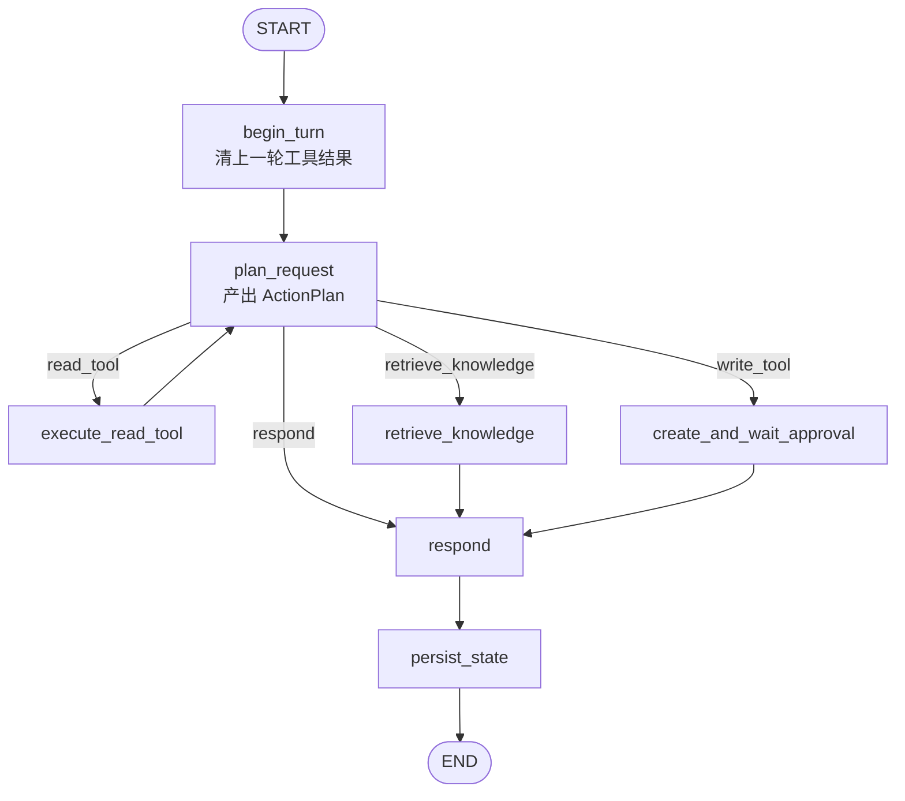

# 多智能体平台实战（二）：图的形状比模型重要

> 上一篇定完了骨架。这一篇进到最核心的技术选择：
> 为什么不用现成的 ReAct Agent，非自己画图不可。答案不在模型能力上，在**路由**上。

---

## 系列导航

| 篇 | 主题 | 回答的问题 |
|---|---|---|
| 1 | 定位与骨架 | 它到底是什么，做哪几件事，不做哪几件事 |
| **2** | **图的形状** | 为什么不用现成的 ReAct Agent，非自己画图不可 |
| 3 | 写操作审批 | 模型要改生产数据时，怎么把它拦住并留下证据 |
| 4 | 知识库 | 权限为什么必须在打分之前过滤 |
| 5 | 连接器 | 内网系统和外网智能体怎么接到同一个工具面上 |
| 6 | 工具与观测 | 谁能调什么由谁说了算，出事之后怎么倒查 |
| 7 | 编排 | 固定流程怎么从提示词里拿出来 |

**本篇小节**：四个原语 → ReAct 的形状问题 → 七节点图 → 规划器不调工具 → 结构化输出的坑 → 代价。

---

## 1. What：LangGraph 只有三个概念加一个设施

LangGraph 把智能体工作流建模成有向图，官方概念只有四个：

1. **State**：共享状态，通常是 `TypedDict`，每个键可以有独立的 reducer；
2. **Node**：普通 Python 函数，收 State，返回**增量**；
3. **Edge**：决定下一个节点是谁。普通边写死，条件边由函数返回值决定；
4. **Checkpointer**：把每一步状态存下来，让图能中断、能恢复、能跨请求续跑。

官方那句总结很好用：**节点干活，边指路。**

一个能跑的最小图长这样（这是全文唯一一次贴完整骨架，后面都只贴核心逻辑）：

```python
class State(TypedDict):
    messages: Annotated[list, add_messages]   # reducer：追加而非覆盖
    plan: dict | None
    step: int

builder = StateGraph(State)
builder.add_node("plan", plan)
builder.add_node("act", act)
builder.add_edge(START, "plan")
builder.add_conditional_edges("plan", route, {"act": "act", "done": END})
builder.add_edge("act", "plan")     # 循环：工具跑完回到规划
graph = builder.compile(checkpointer=checkpointer)
```

三个容易写错的地方，全是新手坑：

- **节点只返回增量**。返回整个 State 会覆盖掉别的键（除非那个键有 reducer）；
- **`messages` 必须配 `add_messages`**，否则第二轮丢历史；
- **条件边的字典映射不是可选的**。直接把函数返回值当节点名，改名时到处要改。

---

## 2. Why：ReAct 的循环形状是固定的

官方入门示例是 `create_react_agent`，五行代码出一个会调工具的 Agent。它的循环是：

**模型 → tool_call → 工具结果 → 模型 → …** 一直到模型不再调工具。

问题不在这个循环好不好，在于**平台的三种能力走的路径根本不同**：

| 能力 | 路径 | 收尾方式 | 要记什么 |
|---|---|---|---|
| 只读工具 | 执行完回到规划器，可能还要再调一次 | 规划器决定继续或结束 | 工具名、参数、耗时 |
| 知识检索 | 走检索，合成答复，**不回到规划器** | 直接输出结论 + 引用 | 命中哪几片、哪份文档 |
| 写操作 | **不执行**，建审批单，然后中断 | 等第二个请求恢复 | 单号、参数哈希、边界快照 |

三列对照下来，结论很清楚：这三种不是同一个循环的三次迭代，是三个不同的终点。

硬塞进 ReAct 循环会发生什么？你会开始在 system prompt 里写这种句子：

> 如果用户要求修改数据，请不要调用工具，而是告诉用户你需要确认。

**这句话出现的瞬间，就说明形状选错了。** 用提示词去约束一个本该由代码保证的路由，
等于把安全边界交给模型的理解力——而模型的输出是不可复现的。

---

## 3. How：七个节点，三条出口

自己画图的直接收益是：**每条边都是一个显式的决策点，可以断言、可以测、可以记日志。**



四类路由，四条边，没有一条依赖模型「想不想」。规划器只输出一个决定，代码负责执行这个决定。

### 3.1 `begin_turn` 为什么排第一位

它干的活很单调：**清掉上一轮留在 checkpoint 里的工具结果**。

不清会怎样？新一轮的规划器会看到上一轮的工具返回，把它当成本轮的证据。
表现是「用户问了一个新问题，回答里带着上一个问题的数据」。

这个 bug 只在多轮对话里出现，单轮测试永远抓不到。等到用户报上来，
你手里只有一段「看起来正常」的对话记录。

### 3.2 条件边要写成字典

```python
builder.add_conditional_edges(
    "plan_request",
    route,                                    # 返回 action 字符串
    {"read_tool": "execute_read_tool",
     "retrieve_knowledge": "retrieve_knowledge",
     "write_tool": "create_and_wait_approval",
     "respond": "respond"},
)
```

字典不只是「别名映射」，它是**校验表**。哪天新增一种 action 忘了加映射，
LangGraph 会直接报错，而不是静默走到 `END`。这类错误在演示阶段看不见，
在生产上表现为「用户问了，机器人没答」。

---

## 4. How：别让模型自由发 tool_call

这是整个系列里最反直觉的一条建议。

最自然的做法是把工具清单丢给模型，让它自己选、自己填参数。问题是平台必须在
「模型想调工具」和「真的调工具」之间插一层：权限判定、风险分级、审批。

所以规划器**不调工具，只产出一个结构化的 `ActionPlan`**：

```python
class ActionPlan(BaseModel):
    action: Literal["respond", "read_tool", "retrieve_knowledge", "write_tool"]
    tool: str | None
    arguments: dict
    reason: str

planner = model.with_structured_output(ActionPlan, method="function_calling")
```

`reason` 字段不是装饰。它进审计、进可观测、也是排查「模型为什么选了这个工具」的唯一线索。
没有它，你只能看到结果，看不到动机。

### 4.1 一个必须提前知道的坑

`with_structured_output(method="function_calling")` 的实现方式是：给模型一个名为
`ActionPlan` 的函数定义，然后要求它「调用」这个函数。

但模型同时看到了你的二十几个真实工具定义，而供应商**不保证遵守 `tool_choice`**。
于是它偶尔会返回一个真正的工具 tool_call，解析直接失败，表现为「无法解析」。

最难受的是**它是掷硬币式的偶发**：同一句输入，十次里成功九次。
压测跑不出来，用户一天遇到两次。

补救只有两条，缺一不可：

1. **加一次纠正重试**，并且把纠正语放进 system 而不是 user。
   放 user 里会被当成新的一轮用户输入，模型会顺着它重新理解任务；
2. **把失败那次的完整输入留底**。可观测系统里那次 `llm.call` 的 error span
   里存着完整的 prompt，可以离线重放，比盯着日志猜快得多。

---

## 5. Why：委派用子图还是用工具

平台里总会有「这件事交给另一个 Agent 办」的场景。官方给了两种形态：

| 形态 | 做法 | 适合 |
|---|---|---|
| 子图 | 把一个编译好的图当节点塞进父图 | 流程确定的分层，父子共享同一个 State |
| 交接（handoff） | `Command(goto=...)` 把控制权交出去 | 会话主体真的换人，比如转人工 |

这里选了第三种：**把委派做成一个普通工具**，`delegate_to_agent(agent_name, task, refs)`。

理由在用户体验上。子图和交接的共同点是「控制权转移」：父图把执行交给另一张图，
或者把对话交给另一个 Agent。对用户来说，表现是**会话突然换人**——
他对着一个已经换掉的会话历史继续说话，而新 Agent 不知道前一句的上下文来自哪里。

做成工具就不一样了：A 调 `delegate_to_agent`，B 跑完返回一个结果，
A 拿着结果继续答复。用户的视角是「A 把这件事办完再回来」，会话主体始终是 A。

技术上也更干净：委派的入参和出参都是普通值（任务描述、引用列表、结果），
走的是工具调用那条已经校验过的路，不需要为子图额外发明一套状态映射规则。

代价是**灵活性下降**。子图可以让子流程直接读写父图的状态，工具不行——
中间必须显式传参。这个限制是好事：它逼着每次委派边界清晰，
也逼着审计链能记下「这一跳传了什么」。

---

## 6. Trade-off：自己画图的账

**多写多少代码？** 图的搭建本身只有三十行。真正的成本在维护边：
每加一种能力，要改 `ActionPlan` 的 Literal、加条件边映射、加节点函数、加测试。四处。

**换回来什么？** 三样东西：

- **可测**：路由是纯函数，喂一个 plan 进去，断言跳到哪个节点，不用起模型；
- **可观测**：每个节点是一条 span，一条链路看得见在哪一跳停住；
- **可审计**：写操作走的是独立节点，天然有地方插审批，不用在 ReAct 循环里找缝隙。

**什么时候该用现成的？** 如果需求只是「一个能查资料、能算数的助手」，
`create_react_agent` 十分钟能出结果，自己画图是浪费。
分界线是**是否要给不同动作不同的终点**——只要有一种动作需要人工介入，
形状就必须是自定义的。

---

## 7. 本篇小结

- LangGraph 只有四个概念，图的价值在于边是显式的决策点。
- ReAct 循环的形状固定，装不下三条不同终点的路径。
- 规划器只产出 `ActionPlan`，不直接发 tool_call，这一层是插审批的前提。
- 结构化输出会被工具清单带偏，必须有一次纠正重试 + 完整输入留底。

下一篇讲那条最难的路径：**写操作怎么跨两个 HTTP 请求完成，并且在中间不被绕过。**

---

*代码来自 PAP 真实实现，文中只保留核心逻辑，完整源码见 GitHub。*
