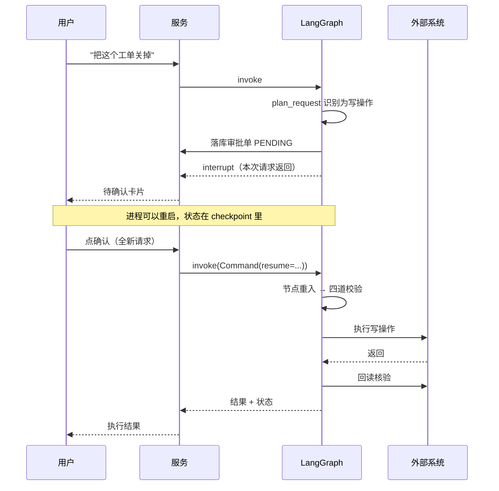

# 多智能体平台实战（三）：写操作必须有人签字

> 前两篇讲的是「怎么想」和「怎么路由」。从这一篇开始讲「怎么不出事」。
> 写操作是整个平台的分界线：能安全地写，它才是平台；不能，它就是个聊天机器人。

---

## 系列导航

| 篇 | 主题 | 回答的问题 |
|---|---|---|
| 1 | 定位与骨架 | 它到底是什么，做什么不做什么 |
| 2 | 图的形状 | 为什么不用现成 ReAct Agent |
| **3** | **写操作审批** | 模型要改生产数据时，怎么拦住并留下证据 |
| 4 | 知识库 | 权限为什么必须在打分之前过滤 |
| 5 | 连接器 | 内网系统和外网智能体怎么接进来 |
| 6 | 工具与观测 | 谁能调什么由谁说了算 |
| 7 | 编排 | 固定流程怎么变成可校验的配置 |

**本篇小节**：为什么不能自动批准 → interrupt 的真实语义 → 跨两次请求的时序 →
四道校验 → 回读核验 → 不确定即未知 → 代价。

---

## 1. Why：为什么不做「低风险免审」

几乎所有平台都会想到这个功能：给工具打风险等级，低风险的自动执行，高风险的找人确认。
省事，体验也好。

这里没有做，原因不是保守，是**判据不可靠**。

「低风险」谁定义？让模型定，等于让它自己决定要不要监督自己。让人定，
那每加一个工具、每改一次参数范围，都要重新评估一遍——评估的人还不是写工具的人。

更麻烦的是**降级的路径**。一开始只给「读工单」定低风险，后来为了体验好，
「改工单状态」也定了低风险，再后来「关闭工单」也进了名单。
每一次都是合理的，加起来就是没有人再看审批单。

所以规则只有一条：**风险等级决定提示的强度，不决定要不要人确认。**
所有写操作走同一条路。

---

## 2. What：`interrupt` 的真实语义

LangGraph 的人机协作原语只有两个函数：

```python
from langgraph.types import Command, interrupt

def create_and_wait_approval(state: State) -> dict:
    payload = build_approval_card(state)
    decision = interrupt(payload)        # 图停在这里，状态进 checkpoint
    return {"decision": decision}

# 另一个 HTTP 请求里恢复：
graph.invoke(Command(resume={"action": "confirm"}), config)
```

看起来是「暂停 → 恢复」。官方文档里有两个事实，写了但非常容易忽略：

**第一，`interrupt` 之后整个图停下，没有任何东西在运行。**
不是线程挂起，不是协程等待，是这次 `invoke` 直接返回了。等待期间进程可以重启。

**第二，恢复时该节点从头重新执行，不是从 `interrupt` 那一行继续。**
`Command(resume=...)` 的值成为 `interrupt()` 的返回值，但节点里 `interrupt()` **之前**的所有代码会再跑一遍。

第二条决定了一条铁律：**`interrupt()` 之前的副作用必须幂等。**

第一次写这段代码的人，十个里有九个会把建审批单写在 `interrupt()` 前面，
然后在测试「取消再确认」时发现库里有三张单子。

正确写法是把创建和中断分开，并且带上去重键：

```python
approval = await ensure_approval(
    idempotency_key=f"{thread_id}:{step}",
    tool=plan.tool, args=plan.arguments,
)
decision = interrupt(card_of(approval))
```

`ensure_approval` 先按 key 查，命中就复用。这样节点重入十次，也只有一张单。

---

## 3. How：一次写操作跨两个 HTTP 请求

这是整个设计里最容易被低估的部分。用户点「确认」时，发起的是一次**全新的 HTTP 请求**，
它没有上一轮的任何内存变量。



三条工程结论：

**checkpointer 必须能跨请求共享。** 生产用 Postgres saver。SQLite 只适合单机演示——
它的问题是「本地全过，重启就废」，因为用的是进程内存里的 saver。

**审批单必须信息自足。** 租户、发起人、工具名、参数、边界快照、有效期，一个不能少。
恢复时没有人能帮你补上下文。

**附件类的东西带不过去。** 写工具不能依赖「用户这一轮上传了什么」——
恢复时那段上下文已经不在。要么提前落库成句柄，要么在第一次请求里就固化进参数。
这里踩过一次真实的坑：导入类工具在核验阶段拿不到会话，解不出附件句柄。

---

## 4. How：在官方原语上补四道校验

`interrupt` 只管「停下来」和「继续」，不管「该不该继续」。确认请求到达时，逐项校验：

| 校验 | 具体判据 | 不做的后果 |
|---|---|---|
| 状态 | 必须是 `PENDING` | 连点两次，写操作执行两遍 |
| 归属 | 请求者是发起人，且同租户 | 拿到 id 就能替我批准 |
| 有效期 | 超过窗口置 `EXPIRED` | 三天前的旧单被翻出来执行 |
| 参数哈希 | 即将执行的参数重算比对 | 单子写 #12，实际执行 #99 |

四道校验的顺序也有讲究，看真实实现：

```python
if approval.status is not ApprovalStatus.PENDING:
    raise ApprovalStateError(...)          # 1. 状态
if not is_actionable(approval, now=now):
    ... mark EXPIRED ...                    # 3. 有效期
else:
    if hash_parameters(confirmed_parameters) != approval.parameter_hash:
        raise ApprovalParameterMismatchError(...)   # 4. 参数哈希
    approval.status = ApprovalStatus.EXECUTING
```

归属校验（第 2 道）在更外层，随查询条件一起下推：`where id=? and tenant_id=? and user_id=?`。
**不要查出来再判**——查得出来本身就说明越权已经发生了一次。

### 4.1 参数哈希是最容易被跳过的一道

算起来只有一行：

```python
def hash_parameters(args: dict) -> str:
    return hashlib.sha256(
        json.dumps(args, sort_keys=True, ensure_ascii=False).encode()
    ).hexdigest()
```

建单时存一份，确认时用**即将执行的参数**重算比对。注意是两个不同的来源：
一个是用户看到的预览，一个是真正要发出去的参数。

没有这道校验，攻击面是这样的：先建一张无害的单子（「查询工单 #12」），
拿到 id 之后，在确认请求的 body 里把参数改成 `{"id": 99, "action": "close"}`。
如果服务端信任 body 里的参数，审批就形同虚设。

### 4.2 连点两次不报错，返回上次结果

第一版写成「第二次直接拒绝」，用户体验很差：网络慢的时候用户点了两下，
第二次弹出一个红色错误，他以为操作失败了，又点了第三次。

真实做法是：状态已经是终态（`EXECUTED` / `VERIFIED` / `EXECUTING` /
`EXECUTION_UNKNOWN` / `RECOVERY_REQUIRED`）时，**返回已有的审批记录，不报错**。
只有中间态（比如别人正在执行）才抛异常。

```python
if approval.status in TERMINAL_OR_RUNNING:
    return approval, False        # 幂等：已经有结论了，直接给
```

这是一个小设计，但它决定了「确认」这个动作可以安全重试。

---

## 5. How：执行成功 ≠ 改对了

写工具执行返回 200，只说明对方收下了请求，不说明它按你的意思改了。
这里要求每个写工具声明一个 `verifier`：执行完立刻去外部系统读一遍，比对结果。

**没有 verifier 的写工具不允许上架。** 否则审批单会永远停在 `EXECUTED` 这个中间态：
既不能说成功（没人核过），也不知道该干什么（没有下一步）。

```python
verified = bool(verification and verification.verified)
status = ApprovalStatus.VERIFIED if verified else ApprovalStatus.EXECUTED
```

### 删除类工具的判据最容易写错

正确形式是「**按 id 查不到，且有删除审计**」。写成「查不到就算删掉了」会漏掉三种情况：

- 行级安全把结果过滤空了——你看不到，但它还在；
- 名字拼错——查的是另一个东西；
- 接口返回空列表但状态码 200——查不到和删干净了长得一模一样。

所以判据必须是正向证据。两样都拿不到时，**停下来报「核不出结论」，不要报成功。**

这条规则很贵：它意味着有些操作会一直是「不确定」。但让账对不上比让人多查一遍贵得多。

---

## 6. How：不确定即未知

外部调用超时、连接被重置、返回体解析到一半失败——这些都不能自动重试，
因为**对方可能已经执行了**。

两个终止态：

- `EXECUTION_UNKNOWN`：不知道结果；
- `RECOVERY_REQUIRED`：需要人介入核对。

它们不是重试的起点，也**绝不能在界面上表述成成功**。宁可让人去系统里查一遍，
也不要让平台的账和实际状态分叉。

---

## 7. Trade-off：这条链的代价

**代价一：每次写都要人点。** 批量场景下很难受。缓解办法是批量合并成一张单
（一次确认提交十条），但不要做「本次会话内不再询问」——那个开关一旦存在，
所有人都会打开。

**代价二：确认有延迟。** 审批窗口通常是分钟级。跨天审批要不要支持？
支持，但有效期要显式写在卡片上，并且过期后强制重新生成预览，不能直接沿用。

**代价三：verifier 要写两遍逻辑。** 执行一次、读回一次，等于接两遍外部接口。
这是最不受欢迎的要求，也是最不能砍的一条。

**它换回来什么？** 一句话：**任何一个写在生产系统上的改动，都能回答「谁批的、
参数是什么、改成了什么样」。** 这句话就是平台和脚本的区别。

---

## 8. 本篇小结

- 自动批准的真实风险是判据退化，不是模型犯错。
- `interrupt` 恢复时节点从头重跑，所以 `interrupt` 之前的副作用必须幂等。
- 确认是全新的 HTTP 请求，审批单必须信息自足。
- 四道校验：状态、归属、有效期、参数哈希，缺一不可。
- 执行成功不等于改对，写工具必须有 verifier；删除类要正向证据。
- 超时进 `EXECUTION_UNKNOWN`，不要重试，不要说成功。

下一篇换主题：**知识库。** 它和审批看起来无关，但共用同一条原则——
权限必须在看到内容之前生效。

---

*代码来自 PAP 真实实现，文中只保留核心逻辑，完整源码见 GitHub。*
