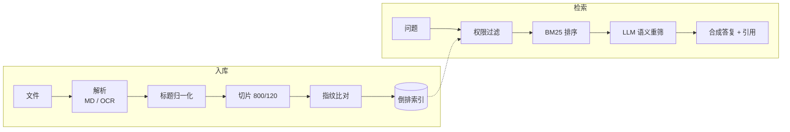

# 多智能体平台实战（四）：知识库，先过滤后打分

> 知识库是最容易被做成「上传 → 向量库 → 搜一下」的功能，也是最容易在上线后
> 出事故的功能。原因只有一个：**权限如果放在检索之后，等于没做。**

---

## 系列导航

| 篇 | 主题 | 回答的问题 |
|---|---|---|
| 1 | 定位与骨架 | 做什么，不做什么 |
| 2 | 图的形状 | 为什么不用现成 ReAct Agent |
| 3 | 写操作审批 | 怎么拦住写操作并留下证据 |
| **4** | **知识库** | 权限为什么必须在打分之前过滤 |
| 5 | 连接器 | 内网系统和外网智能体怎么接进来 |
| 6 | 工具与观测 | 谁能调什么由谁说了算 |
| 7 | 编排 | 固定流程怎么变成可校验的配置 |

**本篇小节**：流水线全景 → 五条入库指纹 → 标题归一化的坑 → 检索顺序 →
BM25 的两个反直觉现象 → 重筛的能力边界 → 评测口径 → 代价。

---

## 1. What：四步，两端

知识库在结构上只有两件事：**把文档变成能检索的片段**，**把问题变成能引用的答案**。



这两端共用一份数据，但**判据完全不同**：入库关心「有没有变」，检索关心「该不该给」。

---

## 2. Why：增量更新不能只看文件变没变

最直觉的做法是记文件哈希，变了就重切。这个做法会在三个月内失效。

失效的场景很具体：你改进了切片器，把 800 字硬切变成按标题层级切。
文件一个字节都没动，但索引该重建了。**哈希没变，切片全变了。**

反过来也有一份错：只改了文件名里的空格，哈希变了，其实内容一个字没变。
全量重建一次，白烧半小时 CPU。

所以增量判据必须是**五条指纹一起看**：

```python
fingerprint = {
    "content_hash": sha256(归一化后的正文),
    "chunk_count": len(chunks),
    "slicer_version": SLICER_VERSION,   # 切片器改了要 bump
    "pipeline": PIPELINE_SNAPSHOT,      # 解析器 / OCR / 清洗规则
    "title": 归一化后的标题,
}
```

五条里任何一条变化就重切。少记一条的结果，要么是「文件更新了但索引没动」，
要么是「什么都没变却全量重建」。前者更危险，因为它不报错。

---

## 3. How：标题归一化要单独收口

中文技术文档的标题里全是符号，国标号尤其麻烦：`GB/T 3836.1-2021`、
`GB∕T 51474-2025`（注意后者那个斜杠是全角除号，肉眼看不出来）。

如果按 `/` 切分做归一化，会发生两件事：

1. `GB/T 3836.1` 被切成 `GB` 和 `T 3836.1`，标准号被切坏；
2. 两份不同文档的标题归一化后撞在一起，被认成同一份，后入库的覆盖前一份。

所以归一化只在一个地方做，规则也只写一份：

- **不按 `/` 切**——国标号里它就是结构的一部分；
- **短横线不参与切分**——`-2021` 是年份，不是分隔符；
- 全角、半角、各种斜杠先统一，再比对。

这件事看起来是细节，但它决定了两件正事：去重靠不靠得住，引用能不能落到正确的那份文档。

---

## 4. How：检索顺序不能反

这是本篇最重要的一节。

```python
candidates = []
for record in self._records:
    if record["access_scope"] not in allowed_scopes:   # 1. 分级
        continue
    if not _is_visible_for(record, roles=roles, user_id=uid):  # 2. ACL
        continue
    if not query_tokens & self._tokens[i]:              # 3. 字面交集
        continue
    candidates.append((i, scores[i]))
candidates.sort(key=lambda x: -x[1])                    # 4. 排序
```

**先过滤，后打分。** 顺序反过来的后果不是「结果不准」，是「内容已经进了模型上下文」：

```
先打分后过滤：取 top 20 → 打分 → 过滤掉 15 条 → 剩 5 条
                                 ↑
                    被过滤的 15 条已经参与过打分，
                    某些实现里已经进入了重筛的 prompt
```

LLM 语义重筛是把候选片段拼进 prompt 里让模型判断相关性。如果过滤发生在这之后，
那些不该看的内容已经「被读过」了。删掉输出不等于没读过——模型可能引用它，
也可能在生成里泄露出它的存在。

正确顺序：`分级 → ACL → 字面交集 → 排序 → 重筛`。

### 4.1 权限是三层，不是一层

| 层 | 判据 | 作用 |
|---|---|---|
| 数据分级 | `access_scope ∈ {public, internal, confidential}` | 决定这个人能不能碰这一类 |
| 可见性 | `user_private` + `owner_user_id` | 个人文档只给本人 |
| 角色 | `allowed_roles` 与用户角色取交集 | 部门级共享 |

三层是**与**的关系，缺一层就有一条绕过路径。比如只做分级不做可见性，
同租户里任何人都能搜到别人上传的私人笔记——而这两类数据在同一个 `internal` 分级下。

---

## 5. Why：BM25 有两个反直觉现象

第一个现象：**小语料下 BM25 会给负分。**

IDF 的公式在「某个词出现在全部文档里」时会变成负数。新租户刚传了第一份文档，
所有词都在这份里，全部 IDF 为负，总分自然为负。

这时候如果拿 `min_score` 去卡阈值，唯一那份文档会被判成不相关。
用户看到的现象是「上传成功了，但搜不到」，第一反应是上传失败，去重传，还是搜不到。

处理办法是**阈值只对正分生效**：

```python
if min_score > 0 and score > 0 and score < min_score:
    skip
```

相关性由「查询词必须与切片有字面交集」这个前提保证，BM25 只负责排序，不负责判相关性。

第二个现象：**只命中标题也算命中。**

因为索引的词表里包含标题和章节名的加权词项。好处是「问标准号能搜到」，
代价是权重容易失衡——标题里带「放散阀」三个字的一份 CJ/T 标准，
会碾压正文里详细讲放散阀操作的另一份文档。

这不是 bug，是排序权重的问题。解法是调 boost，不是改召回口径。

---

## 6. Why：重筛只能剔除，不能补救

候选片段拼进 prompt，让模型逐条判断「这段跟问题相关吗」，输出保留的编号。
这个动作的能力边界必须说清楚：

- **它能做**：把字面撞上但语义无关的片段剔掉（假阳性）；
- **它不能做**：把没进候选的相关片段找回来。

因为它的输入就是候选集。候选集里没有的东西，它变不出来。

所以「效果不好就调重筛」是一条死路。效果不好先看两件事：
零召回的用例有多少（召回上限问题），以及排序前三有没有命中（排序问题）。

还有一个工程量：重筛的 prompt 长度必须 ≥ 切片长度。这里切片 800 字，
重筛 prompt 上限设 900。设小了会截断，被截断的片段在模型眼里只剩半句话，
判断自然不准——而这个错不会报错，只会让指标悄悄变差。

---

## 7. How：评测要防三种自欺

**第一种：测了一个简化版链路。**
评测代码自己拼候选、自己打分，跑出来的分数和线上检索器做的事不一样。
必须走**真实检索入口**，包括权限过滤。否则 0.9 的分数毫无意义。

**第二种：把没标注的算进分母。**
用例标了「应该找到」，才进命中率的分母。没标期望的进 `unscored`，
单独统计，不参与计算。混进去会让指标看起来更差，然后你会去优化一个不存在的问题。

**第三种：拿单次数字当结论。**

这条最贵。同一份索引、同一批标注，连跑三次：

| 次数 | hit@k | MRR | 重筛保留数 |
|---|---|---|---|
| 1 | 0.809 | — | 0/12 |
| 2 | 0.809 | — | 0/12 |
| 3 | 0.857 | 0.802 | 1/12 |

差异全部来自语义重筛。即使 `temperature=0`，多候选排序在浮点边界上仍会翻。
**结论是：看趋势，不看单次；掉两条以内不算回归。**

更危险的错误是「为了让分数好看去改标注」。那不是优化，那是改考卷。
标注错了比没标注更糟——没标注只是不计分，标错了会把你引向错误的方向。

---

## 8. Trade-off：没有向量库的代价

这一版用的是 **BM25 + LLM 语义重筛**，没有向量检索。理由和代价都要讲清楚。

**省下来的**：embedding 版本管理、索引重建、切片粒度与向量维度的耦合、
跨语言的模型选型、一份额外的存储。这些工作量比想象中大，而且是长期的。

**付出去的**：同义改写的召回。用户问「报警了怎么办」，文档里写的是「异常告警处置」，
字面交集为零，直接召回不到。重筛救不了，因为候选集里没有。

**什么条件下该上向量**：当零召回用例里，**同义改写占了多数**的时候。
判据很具体——把 miss 的用例逐条看一遍：

- 如果多数是「字面撞车导致排序错」→ 调权重，不用向量；
- 如果多数是「一个字都没对上」→ 该上向量了，并且**向量通道不能复用字面交集前提**。

第二条很关键。加向量通道时如果还留着「查询词必须与切片有交集」这个前置条件，
语义相关的零字面交集片段照样进不来，等于白接一条通道。

---

## 9. 本篇小结

- 增量判据是五条指纹，只看文件哈希会漏掉切片器升级。
- 标题归一化要单独收口，国标号里的 `/` 和 `-` 不是分隔符。
- 检索顺序：分级 → ACL → 交集 → 排序 → 重筛。反了就是「内容已经进过模型上下文」。
- BM25 在小语料下会给负分，阈值只能对正分生效。
- 重筛只能剔假阳性，救不回零召回。
- 评测走真实链路，未标注不进分母，看趋势不看单次。

下一篇讲外部系统怎么接进来：**连接器。** 核心是一句话——端点配置一次，凭据按租户发。

---

*代码来自 PAP 真实实现，文中只保留核心逻辑，完整源码见 GitHub。*
