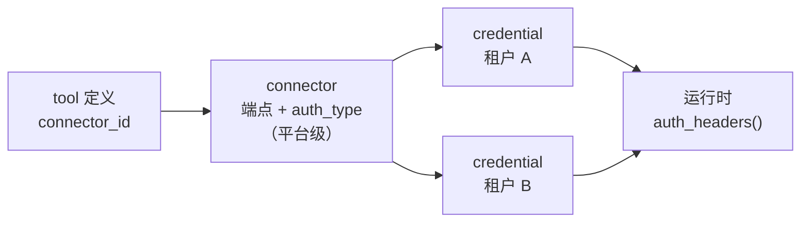

# 多智能体平台实战（五）：连接器，配一次，凭据按租户发

> 平台迟早要接外部系统。这一篇讲怎么接得不难看：地址和认证方式只配一次，
> 凭据按租户各存一份，工具只记住一个 id。

---

## 系列导航

| 篇 | 主题 | 回答的问题 |
|---|---|---|
| 1 | 定位与骨架 | 做什么，不做什么 |
| 2 | 图的形状 | 为什么不用现成 ReAct Agent |
| 3 | 写操作审批 | 怎么拦住写操作并留下证据 |
| 4 | 知识库 | 权限为什么必须在打分之前过滤 |
| **5** | **连接器** | 内网系统和外网智能体怎么接进来 |
| 6 | 工具与观测 | 谁能调什么由谁说了算 |
| 7 | 编排 | 固定流程怎么变成可校验的配置 |

**本篇小节**：三种来源 → 为什么不把凭据放进 `.env` → 数据模型 → 三条硬规则 →
内网放行的判据 → OpenAPI 导入的四个拒绝 → MCP 出向与入向 → 代价。

---

## 1. What：工具只有三种来源

平台要接外部系统，工具来源必须收敛。不收的后果是半年后没人知道某个工具是从哪来的。

| 来源 | 典型 | 关键约束 |
|---|---|---|
| 内置 | 时间、计算、文件读写、沙箱执行 | 风险等级写死在代码里 |
| 远程 MCP | 外部工具服务器、外网智能体 | **逐条登记**，未登记的永不进模型目录 |
| 自定义 HTTP | 内网 OA、工单、台账 | 从 OpenAPI 导入，地址与认证走连接器 |

三者共用一个注册表。**注册表是唯一出口**：模型看到什么工具、能不能调它，
全部从这张表来。任何「临时给某个 Agent 开一个工具」的口子，最后都会变成权限黑洞。

---

## 2. Why：为什么凭据不能放 `.env`

最省事的做法是把外部系统的令牌写进环境变量，工具代码直接读。

这个做法在三处崩：

**第一，多租户。** A 公司和 B 公司接的是同一套 OA，但账号不同。`.env` 只能放一份。

**第二，回退风险。** 一旦代码里有「凭据缺失时读环境变量」的逻辑，
本地测试永远通过，生产上用的是开发环境的令牌——而这条路径不会报错。

**第三，审计。** 「谁在什么时候用了哪个系统的哪份凭据」这个问题，`.env` 答不出来。

所以拆成两层：



**端点与认证方式写一次**（平台级，管理员维护），**凭据按租户各存一份**
（挂行级安全），工具定义只记一个 `connector_id`。

---

## 3. How：三条硬规则

### 规则一：凭据缺失 fail-closed

```python
credential = await session.scalar(
    select(ConnectorCredential).where(
        ConnectorCredential.connector_id == connector.id
    )
)   # 会话已带租户上下文，RLS 自动过滤
if credential is None:
    raise ToolCredentialMissingError(...)
```

不查 `.env`，不查全局配置，不回退。宁可报错，不要用一个错的凭据成功。

这条规则的代价很直接：新租户第一次配连接器必须填凭据，不能「先跑起来再说」。
收益是**不存在「看起来能用但用错了身份」的状态**。

### 规则二：连接器停用，工具从目录消失

不是调用时拒绝，是**根本看不见**。

差别在于模型的行为。如果工具还在目录里但调用会失败，模型会反复尝试——
它只能从错误信息里学，而错误信息往往被它当成「参数不对」，于是换参数重试三次。

工具直接从目录消失，模型第一轮就知道这条路不存在，会走别的路。

### 规则三：敏感字段只在对应认证方式下保存

这条踩过一次真实的泄露。原来的代码不管什么认证方式，都把请求头名原样存下来：

```python
# 错误做法：bearer 认证也存 auth_header_name
return header
```

问题在于：`auth_type=bearer` 时，头名根本不参与请求（固定发 `Authorization: Bearer`）。
但用户可能把令牌贴进了「头名」这个输入框，于是**令牌明文躺进 `connectors` 表**——
那张表是平台级、没有行级安全，又被列表接口原样回显给前端。

既没起作用，又漏了。修法是让 `bearer` 分支返回空字符串，只保留真正用到的字段。

同一个函数里还有一条：**MCP 连接器只支持 Bearer。** 给它配 Basic 或自定义头，
结果是一串「明明配了凭据却还是 401」——这类错最难查，因为配置看起来完全正确。

---

## 4. Why：内网地址要故意放行

自定义 HTTP 工具会拦三类地址：

```python
_BLOCKED_HOSTS = {"169.254.169.254", "metadata.google.internal"}

if host in _BLOCKED_HOSTS:
    raise ...
if address.is_link_local or address.is_unspecified:
    raise ...
```

**它不拦私有网段。** 这不是遗漏，是需求。

平台的用途就是接内网办公系统。拦掉 `10.0.0.0/8`、`172.16.0.0/12`、`192.168.0.0/16`
等于宣布这个功能不可用。

所以判据是「拦什么」和「为什么拦」：

| 拦 | 理由 |
|---|---|
| `169.254.169.254` / 云元数据域名 | SSRF 的经典目标，能换走机器身份凭据 |
| `169.254.0.0/16`（链路本地） | 同上，含各家云的元数据地址段 |
| `0.0.0.0` / 未指定 | 在某些栈上等价于本机，行为不可预期 |
| **私有网段** | **不拦。这是功能本身** |

这个决定要写进文档。否则下一个人做安全评审时，第一反应是把它当漏洞报上来。

---

## 5. How：OpenAPI 导入的四个拒绝

从 OpenAPI 文档导入工具很方便，也很容易导进一堆不该存在的东西。四条硬拒绝：

| 拒绝 | 理由 |
|---|---|
| `servers[0].url` 是相对路径 | 导入时无法解析成绝对地址，等于埋一个运行期错误 |
| 参数里出现 `Authorization` / `Cookie` / `Host` | 这些必须由连接器注入，不能由调用方传 |
| 操作没有 `operationId` | 生成不出稳定的工具名，改名就断调用 |
| 请求体 schema 不是对象 | 参数没法逐项展示给用户确认 |

第三条和审批直接相关：**参数必须能逐项展示**，人才能看懂自己要批的是什么。
一个 `body: string` 的工具，确认卡片上只能显示一大段 JSON，
等于让人闭着眼睛签字。

---

## 6. How：MCP 两个方向

### 6.1 出向：逐条登记

远程 MCP Server 暴露的工具，**不自动全量进目录**。要管理员逐条登记，
选择这个工具的风险等级、是否需要审批。

理由和「不做自动批准」一致：MCP Server 是别人维护的，它今天加了什么工具、
明天改了什么语义，你不该被动接受。

### 6.2 入向：只开两个工具

外部智能体也要能调这个平台。入向 MCP 只暴露两个：

- `pap_delegate`：交一整段意图过去；
- `pap_task_status`：按任务 id 取回结果。

为什么不把「查台账」「查知识库」「跑编排」拆成独立工具？因为那等于让调用方
替平台做规划——而**这些能力之间的上下文（站点、型号、告警等级）唯一的交汇处，
就是平台自己的规划器**。拆开之后调用方得自己记住上一跳的结论再决定下一跳，它做不到。

三条硬规则：

**写操作永不在这里执行。** 只返回 `awaiting_approval`，让调用方请人去控制台确认。
30 秒的响应窗口撑不住一次人工审批。

**超时移交 task_id。** 长任务不阻塞连接，返回句柄让对方轮询。轮询提示要写进返回体，
否则对方会重新委派同一个任务，跑出两份结果。

**两条凭据都没配就全拒 401。** 不要有「其中一个配了就行」的宽容判断。

### 6.3 一个必须提前说的坑

连接器里填 `127.0.0.1`，指的是**服务端自己的回环**，不是你的笔记本。

本机开发想接自己机器上的 MCP Server，正确做法是反向隧道：

```bash
ssh -N -R 18000:127.0.0.1:8000 pap
```

然后在平台里填 `http://127.0.0.1:18000/mcp`。不知道这一条，会在这个报错上
浪费两小时，而且报错信息是 `MCP_PROTOCOL_ERROR`，完全指不到网络问题上。

---

## 7. Trade-off：这层的三笔账

**多一层配置。** 接一个系统要建连接器、填凭据、导入或登记工具，三步而不是一步。
换回来的是换租户不用改代码、停用不用发版。

**内网放行 = 多一个 SSRF 面。** 平台能访问内网任意地址，这是设计意图，
也意味着「谁能建连接器」本身就是敏感权限。控制点是连接器的写权限，
不是网络层——这一点要在权限模型里显式写清。

**入向 MCP 只开两个工具，表达能力受限。** 调用方不能精确指定「只要查台账」，
必须把意图整体交给平台。代价是调用方失去细粒度控制，收益是平台能保证
每一跳都在权限与审计之内。

**还有一笔隐性的账：文档漂移。** OpenAPI 导入是一次性的快照，外部系统后来
改了字段或者加了必填参数，平台这边的工具定义不会自动跟着变。表现是「昨天还能用，
今天报参数错误」。缓解办法不是自动同步（那会让审批过的工具定义随时被第三方改动），
而是在调用失败时把 HTTP 状态码和错误体原样记进审计，让排查有个起点。

---

## 8. 本篇小结

- 工具只有三种来源，都从同一个注册表出去。
- 端点配一次、凭据按租户存，工具只记 `connector_id`。
- 凭据缺失必须 fail-closed，不回退 `.env`。
- 停用连接器，工具从目录消失，而不是调用时拒绝。
- 敏感字段只在对应认证方式下保存，否则会明文落进平台级表。
- 内网地址是故意放行的，拦的是元数据服务和链路本地。
- 入向 MCP 只开委派与查询两个工具，写操作永不在此执行。

下一篇讲这个平台最容易被忽略的一层：**工具网关与观测。**
它的核心是一个纯函数——`agent_denial`，以及为什么目录和执行必须共用它。

---

*代码来自 PAP 真实实现，文中只保留核心逻辑，完整源码见 GitHub。*
